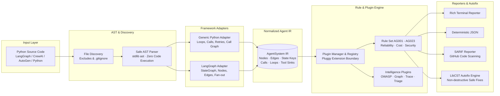
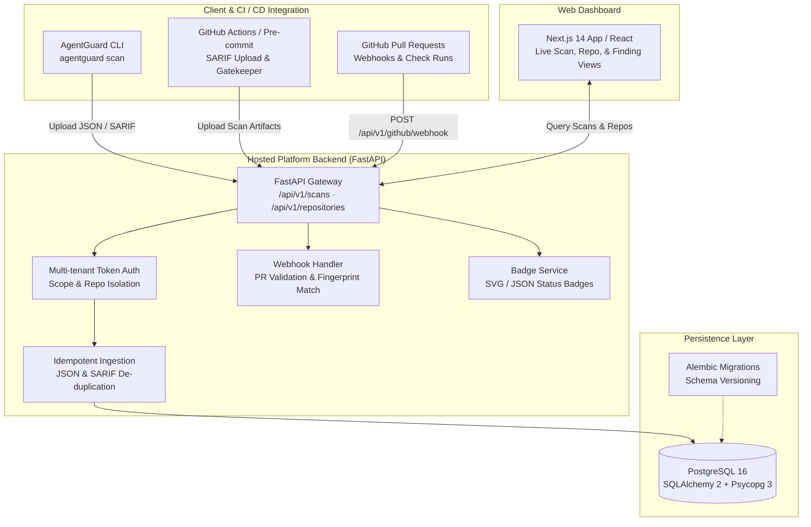

# AgentGuard

[](https://github.com/noviciusss/AgentGuard/actions)
[](https://www.python.org/downloads/)
[](LICENSE)
[](https://github.com/astral-sh/ruff)
[](https://mypy-lang.org/)

**AgentGuard** is a static analysis CLI and hosted security platform for AI agent codebases (LangGraph, CrewAI, AutoGen, and custom Python agents).

It detects reliability, cost, and security vulnerabilities in agent execution graphs, LLM invocations, retry loops, and tool boundaries **before the agent ever runs**.

> **Mental Model:** `ruff` + `bandit` + `semgrep`, purpose-built for agent architectures. It catches runaway loops, unhandled tool failures, missing timeouts, unbounded state growth, and prompt injection sinks before deployment.

---

## Architecture

AgentGuard separates source-code parsing and framework semantics from rule evaluation using a normalized **Agent Intermediate Representation (IR)**. Core analysis is completely offline and safe: code is parsed into abstract syntax trees without ever being imported or executed.

### 1. Static Analysis Pipeline



### 2. Full Platform Architecture (CLI, API, & Web Dashboard)



---

## Key Features

- **100% Offline & Safe Analysis**: Code is inspected purely via Python's `ast` parser. It is **never imported or executed**, and the core scanner makes **zero network requests**.
- **Agent IR Normalization**: Understands agent-specific constructs: state machines, node transitions, conditional routing, recursion limits, fan-out branches, shared mutable state, and tool schemas.
- **15 Built-in Specialized Rules**: Comprehensive coverage across agent reliability (deadlocks, infinite loops, unbounded retries), cost explosions (unpinned model aliases, missing budgets), and security vulnerabilities (prompt injection sinks, unsanitized LLM output to shell, hardcoded secrets).
- **OWASP LLM Top 10 (2025) & CWE Mapping**: Automated tagging of findings against industry-standard AI security taxonomies.
- **Non-destructive Autofix**: Powered by `libcst`, AgentGuard safely patches missing timeouts, recursion limits, and model pins while preserving existing code formatting and comments.
- **Mermaid Graph Visualizer (`agentguard graph`)**: Renders normalized state graphs directly from source code into Mermaid diagrams for review and documentation.
- **Runtime Trace Analyzer (`agentguard trace`)**: Ingests OTLP and LangSmith trace exports to detect repeated runtime loops (`TRACE001`) and execution cost spikes (`TRACE002`).
- **Hosted Platform & Next.js Dashboard**: Standalone FastAPI server and Next.js 14 web UI with tenant token isolation, audit logging, idempotent ingestion, and GitHub pull request webhooks.

---

## Built-in Detection Rules

| Rule ID | Category | Severity | Name & Summary | Autofix |
|:---|:---|:---|:---|:---:|
| **AG001** | Reliability | `error` | **Unbounded Retries**: Retries without explicit max attempts or exponential backoff | No |
| **AG002** | Reliability | `error` | **Shared Mutable State in Fan-out**: Concurrent fan-out branches mutating shared state keys | No |
| **AG003** | Reliability | `warning` | **Missing Timeout**: Outbound HTTP or LLM API calls without explicit network timeout | **Yes** |
| **AG004** | Reliability | `error` | **Unbounded Agent Loop**: Graph invocation or loop missing recursion limits | **Yes** |
| **AG005** | Cost | `warning` | **Missing Cost Budget**: Agent loop or execution missing cost or token budget limits | No |
| **AG006** | Reliability | `error` | **Unreachable Graph Node**: Graph node without inbound edges from entry points | No |
| **AG007** | Reliability | `error` | **Conditional Edge Unmapped Key**: Router returns branch keys missing from path map | No |
| **AG008** | Reliability | `warning` | **Exception Swallowed in Tool**: Bare `except` or generic error suppression in tool body | No |
| **AG009** | Reliability | `error` | **Non-Idempotent Tool with Retry**: Destructive tool calls wrapped in retry policies | No |
| **AG010** | Cost | `warning` | **Unpinned Model Alias**: Floating alias like `gpt-4` or `latest` instead of pinned revision | **Yes** |
| **AG011** | Cost | `warning` | **Unbounded State Growth**: Appending to state collections without truncation or sliding window | No |
| **AG020** | Security | `error` | **Prompt Injection Sink**: Untrusted input concatenated directly into system prompt (OWASP LLM01) | No |
| **AG021** | Security | `error` | **Dangerous Tool Without Human Approval**: Destructive actions (shell, DB drop) without HITL gate (OWASP LLM06/08) | No |
| **AG022** | Security | `error` | **LLM Output to Dangerous Sink**: Model output piped directly into `eval`, `exec`, or shell (OWASP LLM02) | No |
| **AG023** | Security | `error` | **Hardcoded Secret**: Exposed API keys, auth tokens, or credentials in agent configuration | No |

*Detailed remediation guides, bad examples, and good examples are available in [`docs/rules/`](docs/rules/) or via `agentguard explain <ID>`.*

---

## Quick Start

### Installation

AgentGuard requires Python 3.10+ and recommends `uv` for reproducible environments:

```bash
# Clone the repository
git clone https://github.com/noviciusss/AgentGuard.git
cd AgentGuard

# Sync locked environment with all extras
uv sync --locked --all-extras
```

### Running Scans

Scan your codebase or bundled examples:

```bash
# Scan a directory
uv run agentguard scan examples/

# Run scan with text or JSON formatting
uv run agentguard scan src/ --format text
uv run agentguard scan src/ --format json --output findings.json

# Filter by rule, severity, or confidence
uv run agentguard scan src/ \
  --select AG001,AG00* \
  --ignore AG003 \
  --min-severity warning \
  --min-confidence medium \
  --fail-on error
```

### Inspecting Rules & Remediation Guidance

```bash
# List all registered rules and metadata
uv run agentguard rules

# Explain specific rule with code examples and fix guidance
uv run agentguard explain AG003

# List active plugins
uv run agentguard plugins list
```

### Autofix with LibCST

Preview changes non-destructively:

```bash
# Preview diffs without modifying files
uv run agentguard scan src/ --fix-dry-run

# Apply safe fixes directly (e.g., adding timeouts or recursion limits)
uv run agentguard scan src/ --fix
```

### Agent Graph Visualization

Extract the state machine and render a Mermaid graph:

```bash
# Output Mermaid diagram to stdout or file
uv run agentguard graph examples/langgraph_support_bot --output graph.mmd
```

### Runtime Trace Analysis

Analyze execution traces for loops or cost spikes:

```bash
# Scan OTLP / LangSmith trace JSON exports
uv run agentguard trace path/to/trace.json
```

### Baseline Creation

Suppress existing legacy findings and fail CI only on newly introduced bugs:

```bash
# Generate a baseline snapshot
uv run agentguard baseline create src/ --output .agentguard-baseline.json

# Scan against the baseline
uv run agentguard scan src/ --baseline .agentguard-baseline.json
```

### Inline Suppressions

Suppress specific warnings with an audit reason in code review:

```python
# agentguard: ignore[AG003] reason: network gateway injects default timeout
response = requests.get(url)
```

---

## Phase 6 Hosted Platform & Dashboard

AgentGuard includes an optional enterprise platform: a standalone FastAPI REST backend, PostgreSQL storage with Alembic migrations, and a Next.js 14 web dashboard.

### Quick Start with Docker Compose

The fastest way to launch the full platform locally:

```bash
# Prepare environment variables
cp .env.example .env

# Build and start PostgreSQL (port 5432) and FastAPI (port 8000)
docker compose up --build
```

Verify service readiness:

```bash
curl -fsS http://localhost:8000/healthz
# Output: {"status":"ok","service":"agentguard-server"}
```

Explore the interactive API contract at [http://localhost:8000/docs](http://localhost:8000/docs).

### Running the Next.js Dashboard

The dashboard provides a unified view of monitored repositories, scan histories, and detailed finding breakdowns:

```bash
cd web
npm ci
AGENTGUARD_API_URL=http://localhost:8000 npm run dev
```

Open [http://localhost:3000](http://localhost:3000) to view the web dashboard.

### API Ingestion & CI Integration

Submit findings directly from GitHub Actions or CI runners:

```bash
# Ingest JSON scan report (idempotent by scan_key)
curl -X POST http://localhost:8000/api/v1/scans \
  -H 'Content-Type: application/json' \
  -d '{
    "scan_key": "ci-run-1042",
    "repository": {"provider": "github", "full_name": "acme/agent-fleet"},
    "branch": "main",
    "commit": {"sha": "9f83a21"},
    "analyzer_version": "0.1.0",
    "findings": []
  }'

# Ingest standard SARIF scan output
curl -X POST \
  "http://localhost:8000/api/v1/scans/sarif?scan_key=ci-1043&repository=acme%2Fagent-fleet&branch=main&commit_sha=9f83a21&analyzer_version=0.1.0" \
  -H 'Content-Type: application/json' \
  --data-binary @agentguard-results.sarif
```

---

## Development & Testing

### WSL & Environment Setup

WSL Ubuntu users should set the following environment variables to ensure optimal file I/O and cross-filesystem safety:

```bash
export UV_LINK_MODE=copy
export UV_PROJECT_ENVIRONMENT="$HOME/.venvs/agentguard"
export PATH="$HOME/.local/bin:$PATH"
```

### Verification Commands

All changes must pass strict validation before committing:

```bash
# Install locked workspace dependencies
uv sync --locked --all-extras --all-packages

# Run full test, lint, and type check suite
make check

# Individual verification targets
make test         # Run pytest test suite
make lint         # Run ruff check and format check
make fmt          # Auto-format code with ruff
make types        # Strict typecheck with mypy
make server-test  # Run FastAPI server integration suite
```

---

## Repository Structure

```text
agentguard/
├── packages/
│   ├── agentguard-core/          # Core CLI, AST engine, IR models, 15 rules, autofix
│   ├── agentguard-langgraph/     # LangGraph adapter & framework recognizer
│   ├── agentguard-graph/         # Mermaid diagram generator plugin
│   ├── agentguard-owasp/         # OWASP LLM Top 10 (2025) & CWE tagging plugin
│   ├── agentguard-llm-triage/    # Redacted local source LLM triage plugin
│   ├── agentguard-trace/         # LangSmith & OTLP runtime trace analyzer
│   └── agentguard-server/        # Hosted FastAPI server, SQLAlchemy 2, Alembic
├── web/                          # Next.js 14 web dashboard
├── docs/
│   ├── architecture.md           # In-depth architectural design
│   ├── ci.md                     # GitHub Actions & pre-commit integration
│   ├── autofix.md                # LibCST autofix specification
│   ├── server.md                 # Hosted server endpoints and security model
│   └── rules/                    # Comprehensive docs for AG001 - AG023
├── examples/                     # Sample agentic codebases (clean & buggy)
├── tests/                        # Comprehensive unit & fixture test suites
├── Dockerfile                    # Server container definition
├── docker-compose.yml            # Local PostgreSQL + FastAPI orchestration
├── Makefile                      # Standardized build and test targets
└── pyproject.toml                # UV monorepo workspace configuration
```

---

## License

AgentGuard is open-source software licensed under the [MIT License](LICENSE).
